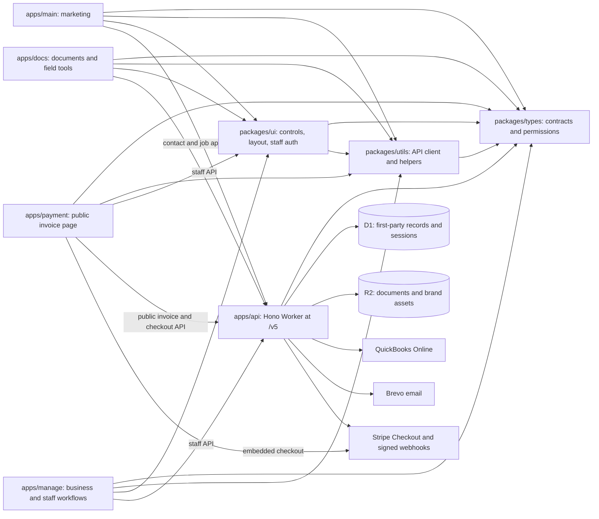
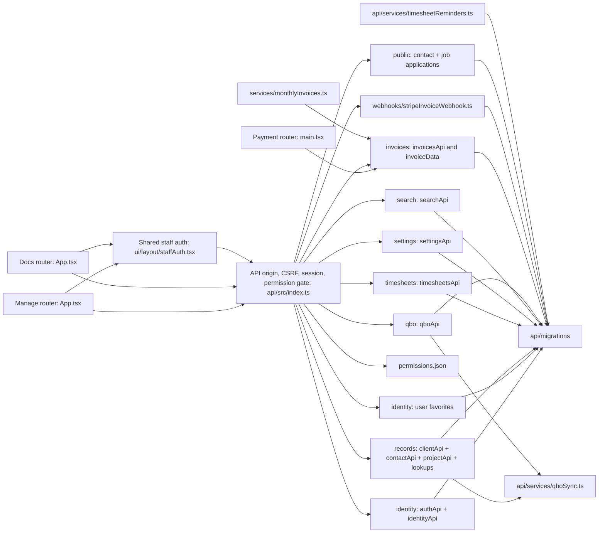
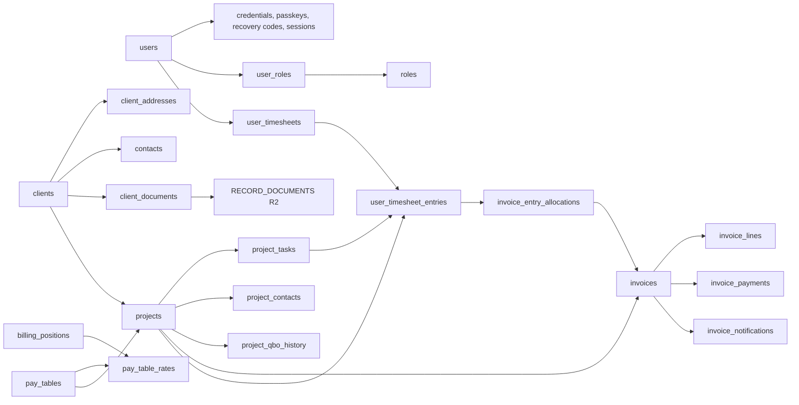

# Codebase knowledge graph

Snapshot: 2026-10-23. This maps the repository as implemented; it is not a deployment claim. The arrows show a dependency or a call, not ownership of the target. Dotted arrows show an expected path with no matching implementation. Start with the route and ownership tables when changing a feature, then follow the source links. Update this document when routes, contracts, persistence, or integration boundaries change.

## System graph

Solid edges reflect package dependencies or implemented calls. The API creates Stripe checkout sessions and verifies webhook signatures before recording payment. Package edges come from each workspace `package.json`; runtime edges come from `apps/api/src/index.ts` and the app entry points.

## Feature graph

The API's public `/v5` prefix is stripped in `apps/api/src/index.ts` before Hono matches paths. `permission()` provides the first staff route gate; handlers enforce project ownership and invoice permissions. Public invoice tokens and the Stripe webhook have separate boundaries. `GET /health/status` is mounted directly. The Worker also has a `scheduled` entry point for timesheet reminders and monthly invoice drafts. `apps/api/wrangler.toml` declares UTC cron pairs; local New York time gates the reminders and 09:00 invoice run across daylight saving changes.

`POST /public/contact` and `/public/job-applications` accept configured first-party origins, validate and rate-limit submissions, and use the central Brevo service with server-owned recipients. `GET` and `PUT /identity/me/favorites` store authenticated Docs favorites in D1. Main, Manage, Docs, and Payment use the shared browser API client where applicable. The local D1 baseline now contains only active invoice allocation fields; project move history and QBO links remain.

## Route and feature index

| Surface | Implemented routes or features | Entry point and owner |
| --- | --- | --- |
| Manage | `/dashboard`, `/search`; `/client`, `/client/new`, `/client/:id`; `/project`, `/project/new`, `/project/:id`; `/timesheets`, `/timesheets/:start`, `/timesheets/review`, `/timesheets/invoice-pool`; `/invoices`, `/invoices/:id`; `/settings`, `/settings/users`, `/settings/users/new`, `/settings/users/:id`, `/settings/roles`, `/settings/qbo`, `/settings/rates`. The invoice list groups client, project, then invoices and preselects approved time for a manual draft; detail recalculates entry decisions, hours comparison, and totals live. | `apps/manage/src/App.tsx`; invoice pages and `invoiceDraft.ts` under `apps/manage/src/pages/invoices`. Most feature pages are lazy loaded. |
| Docs | Home and office pages; field parser and CXL editor; checklists, platting, ALTA references, handbooks, survey notes. Authenticated favorites use `/identity/me/favorites`. | `apps/docs/src/App.tsx`; tool and content modules under `apps/docs/src/pages`. Only survey notes are wrapped in `ProtectedRoutes` in this router; other Docs routes are visible without that route guard. |
| Payment | `/pay/:token` shows the token-scoped invoice, company settings logo, shared PDF, confirmed payments, and embedded Stripe checkout. | `apps/payment/src/main.tsx`, `pages/PayInvoicePage.tsx`; `packages/utils/src/invoicePdf.ts` is the shared PDF renderer. |
| Main | Marketing home, services, V5 contact submission, company, terms, privacy, and two CAD positions with on-site application. | `apps/main/src/App.tsx`, `pages/contactV2.tsx`, `pages/positions`; prerender script is part of the app build. |
| API identity | Setup, password login/reset, TOTP, recovery, passkeys, session, users, roles, permissions. | `apps/api/src/routes/authApi.ts`, `identityApi.ts`, `userDetail.ts`; mounted at `/identity`. |
| API business | Client/project records and lookups, search, company settings and logos, QBO connection/sync, timesheets, invoices, public invoice access and checkout, contact and job submissions, staff favorites, Stripe webhook. | `apps/api/src/routes/clientApi.ts`, `contactApi.ts`, `projectApi.ts`, `recordLookupsApi.ts`, `searchApi.ts`, `settingsApi.ts`, `qboApi.ts`, `timesheetsApi.ts`, `invoicesApi.ts`, `publicApi.ts`, `favoritesApi.ts`, `src/webhooks/stripeInvoiceWebhook.ts`; mounted in `apps/api/src/index.ts`. |

The browser API clients in `apps/manage/src/api/client.ts` and `apps/docs/src/api/client.ts` use `createApiClient` from `@whitepoint/utils`. They default to `http://localhost:8787/v5` on localhost and the production API elsewhere. The public Payment page has a small token request helper and a local API default.

## Ownership and data paths

| Area | Source of truth and entry point | Consumers or effects |
| --- | --- | --- |
| Workspace | `package.json`, `pnpm-workspace.yaml`, each workspace manifest | `types` is shared by all apps; `utils` depends on `types`; `ui` depends on both. |
| Authentication and permissions | `apps/api/src/auth`, `apps/api/src/routes/authApi.ts`, `apps/api/src/index.ts`, `packages/types/src/constants/permissions.json` | Manage and Docs use `packages/ui/src/layout/staffAuth.tsx` and an API-hosted session. |
| Clients and projects | `apps/manage/src/pages/client`, `apps/manage/src/pages/project`, `apps/api/src/routes/clientApi.ts`, `contactApi.ts`, `projectApi.ts`, `recordLookupsApi.ts` | D1 is authoritative. `qboSync.ts` attaches QBO references after local saves; record documents use `RECORD_DOCUMENTS` R2. Shared contracts live in domain files under `packages/types/src/types` (`client`, `contact`, `project`, `task`, `invoicing`). |
| Timesheets and rates | `apps/manage/src/pages/timesheets`, `apps/manage/src/pages/settings/rates`, `apps/api/src/routes/timesheetsApi.ts`, `apps/api/migrations/0005_timesheets.sql` | D1 holds time, approvals, rate snapshots, and the unreserved invoice pool for all billable task types. Worker cron runs reminders. |
| Company settings | `apps/manage/src/pages/settings`, `apps/api/src/routes/settingsApi.ts`, `src/services/companyBranding.ts` | D1 settings hold the company name and logo keys; logos use `BRAND_ASSETS` R2. Staff logo access uses the settings route. |
| Invoicing and payments | `apps/api/src/routes/invoicesApi.ts`, `src/services/invoiceData.ts`, `invoiceCore.ts`, `invoiceQbo.ts`, `monthlyInvoices.ts`, `src/webhooks/stripeInvoiceWebhook.ts`; `apps/manage/src/pages/invoices`; `apps/payment/src/pages/PayInvoicePage.tsx`; `packages/utils/src/invoicePdf.ts` | D1 owns invoices, entry allocations, payment confirmation, notifications, and provider sync state. Invoice branding comes from current company settings, and the V4-inspired PDF renderer is shared by Manage and Payment. Stripe checkout and webhooks, Brevo messages, and QBO sync are external effects. |
| Marketing | `apps/main/src/App.tsx` | Standalone site using shared packages. |
| Documentation | `apps/docs/src/App.tsx`, `apps/docs/src/pages`, `apps/api/src/routes/favoritesApi.ts` | Public content and tools, protected survey notes, and authenticated D1 favorites. |

`packages/types/src/types` holds shared V5 contracts in client, contact, project, task, invoice, and search files. Main owns its single-app job listing type. Internal D1 row and app-specific user and role types stay local to their consumers. `packages/types/src/constants/permissions.json` is the permission catalog used by `PERMISSION_CATALOG` and `PERMISSION_KEYS`. `packages/utils/src/index.ts` exports the API client, session, favorites, dates, numbers, and invoice helpers. `packages/ui/src/input` is the active shared control surface; `packages/ui/src/layout` provides auth, prompts, layout, modals, and error UI. Package export maps in their manifests define the supported import paths, including retained compatibility exports in UI.

### Persistence relationships

Migrations `0001` to `0007` under `apps/api/migrations` define the D1 schema. Records and settings use revision checks; client and project saves batch related rows, audit entries, and numbering changes. Project detail derives approved time cost and charge totals from timesheet entries and invoice summaries from `invoices`. QBO customer, invoice, and payment IDs and sync status are references to an external system; local D1 records remain authoritative. Client document metadata lives in D1 and file bodies live in R2. Dormant invoice reference and timesheet invoice columns were removed from the local baseline; `invoice_entry_allocations` reserves source entries.

| Migration | Main responsibility |
| --- | --- |
| `0001_baseline.sql` | Users, credentials, roles, sessions, clients, contacts, projects, audit, QBO connection. |
| `0002_webauthn_challenges.sql` | Passkey challenge persistence. |
| `0003_manage_settings.sql` | Company settings, numbering sequences, QBO accounting choices. |
| `0004_record_views.sql` | Client addresses/documents, project tasks/contacts, QBO move history, invoice references, record revisions. |
| `0005_timesheets.sql` | Billing positions, pay tables/rates, manager links, timesheets, entries, audit, notifications. |
| `0006_billing_position_local_id.sql` | Optional case-insensitive billing position local ID. |
| `0007_invoices.sql` | Invoice headers and lines, one allocation per source entry, partial payments, notifications, events, and Stripe webhook receipts. |

### Important write paths

1. Manage client and project pages call `/records/*`, mounted from `clientApi.ts`, `contactApi.ts`, `projectApi.ts`, and `recordLookupsApi.ts`. Client/project saves validate the full record, use revision checks and D1 batches, then attempt `qboSync.ts`. QBO failures are stored for later retry. The project detail reads linked contacts/tasks, approved time costs, and invoice references.
2. User detail pages call `identityApi.ts`. The detail API redacts pay and billing fields unless the caller has `timesheets.rates.view`; role and user changes are audited in D1.
3. Timesheet pages call `timesheetsApi.ts`. Draft entries select an active project and task. Submission snapshots rates and supports an explicit zero-hour week. A reporting-chain manager approves or rejects; reopening is manager controlled. Approved T&M, NTE, and fixed fee entries without allocations appear in the invoice pool.
4. QBO setup uses `qboApi.ts` for OAuth callback and choices; `qboSync.ts` writes top-level client customers and child project customers. The callback redirects to Manage settings.
5. Manual invoice creation selects available approved time by default and reserves selected source entries in `invoice_entry_allocations`; a blank draft remains available. The monthly job claims remaining approved entries from before the current month, makes one draft per project and month, and notifies its manager. Draft review previews allocation decisions, task comparisons, and totals immediately; fixed fee amounts follow billed client charges by default up to the remaining task contract amount, with a manager override allowed within that cap. `POST /invoices/:id/entries` reserves additional approved time on an existing draft. An assigned manager or invoice staff member can permanently delete a draft at its current revision, removing related rows and releasing source entries without rewinding invoice numbering; `audit_log` keeps a minimal deletion action. Sending finalizes the invoice, sends the client link, and attempts QBO sync. Confirmed Stripe events or staff entry record payments and update the D1 balance.

### External edges and access boundaries

| Edge | Implemented path | Boundary |
| --- | --- | --- |
| Browser to API | `packages/utils/src/apiClient.ts`, `packages/ui/src/layout/staffAuth.tsx`, `apps/api/src/index.ts` | Allowed origins, session cookie, CSRF token for staff writes, route permissions and project ownership. Public invoice reads and checkout use opaque tokens. |
| API to QBO | `apps/api/src/routes/qboApi.ts`, `apps/api/src/services/qboSync.ts`, `invoiceQbo.ts` | OAuth connection and client/project customer sync plus sent invoice and confirmed payment sync; local D1 writes precede outbound sync, with status/error and retry. Stripe payment export resolves a named QBO Stripe method, uses the configured deposit account, and links to the invoice; customer and invoice billing addresses come from client billing data. Live QBO behavior needs separate verification. |
| API to Brevo | `apps/api/src/auth/mail.ts`, `apps/api/src/routes/timesheetsApi.ts`, `apps/api/src/services/timesheetReminders.ts`, `monthlyInvoices.ts`, `invoicesApi.ts` | Invitation/reset, timesheet, manager draft, and client invoice messages. Invoice notification and email outcome state live in D1. |
| API to R2 | `apps/api/src/routes/clientApi.ts`, `settingsApi.ts`, `invoicesApi.ts`, `src/services/companyBranding.ts` | Protected client documents and logo objects, with D1 metadata/settings. Staff invoice logo reads require invoice access; public logo reads require a sent or paid invoice token. Neither response exposes the R2 key. |
| Payment to Stripe | `apps/payment/src/pages/PayInvoicePage.tsx`, `apps/api/src/routes/invoicesApi.ts`, `apps/api/src/webhooks/stripeInvoiceWebhook.ts` | API creates sessions for the current D1 balance. Signature verified webhook events confirm payment; the browser return URL only refreshes status. |

## Weak areas

| Priority | Evidence | Effect and next action |
| --- | --- | --- |
| High | Stripe, Brevo, and QBO sandbox credentials are not available to the automated API tests. | Verify live provider checkout/webhook timing, email delivery, and QBO invoice/payment mapping in sandboxes before release. |
| Medium | `packages/ui/src/layout/staffAuth.tsx` is about 742 lines; `apps/api/src/routes/identityApi.ts` about 611; `apps/docs/src/pages/office/checklists/checklist.tsx` about 504. | These have broad review surfaces. Split by cohesive flow when modifying them, preserving active exports and routes. |
| Medium | `apps/api/tests` covers invoice timing, allocation math, API rights, Stripe event handling, and QBO retry behavior. `apps/manage/tests/currency.test.mjs` covers one formatting concern; frontend app manifests have no test script. | Run an interactive Manage and Payment review and provider sandbox checkout before release. |
| Medium | Package manifests use `^` ranges for many third-party dependencies despite `AGENTS.md` asking for hard references; the lockfile pins the current resolved tree. | A fresh dependency resolution could change versions. Decide whether the repository policy should require exact manifest versions, then align manifests and lockfile. |
| Low | `.agents/KEY DECISIONS.md` retains Clerk decisions that later entries override. | Read the latest overriding decision before identity work. Keep chronology clear. |

## Build and validation map

Root `package.json` defines `pnpm` workspace build, lint, typecheck, and per-app dev commands. `dev:manage` starts Manage and API; `dev:payment` starts Payment and API. Both app-level `dev` scripts start that app and API. Each path calls `scripts/dev.mjs`, which also starts a Stripe CLI listener for `/v5/webhooks/stripe`. It reads the test Stripe API key from `apps/api/.dev.vars`, obtains the CLI signing secret, and passes it to Wrangler. Stripe CLI access and network connectivity are required for that launch path. The root typecheck first builds `types`, `utils`, and `ui`, then checks workspaces. `apps/api/package.json` defines `node --test`; current tests are in `apps/api/tests`. `apps/manage/tests/currency.test.mjs` exists without a Manage `test` script. Each frontend app builds with TypeScript and Vite; Main also prerenders, using installed Chrome if bundled Playwright Chromium is absent. `apps/*/wrangler.toml` declares the Cloudflare Pages output, and the API Wrangler file declares the Worker resources. Use `pnpm.cmd` in PowerShell if the `pnpm.ps1` execution policy blocks the command. Local D1 reset removes local data and is a separate operation from applying migrations.

The primary source anchors are [API entry](../apps/api/src/index.ts), [Manage router](../apps/manage/src/App.tsx), [Docs router](../apps/docs/src/App.tsx), [Payment page](../apps/payment/src/pages/PayInvoicePage.tsx), [D1 migrations](../apps/api/migrations), [shared type exports](../packages/types/src/index.ts), [shared utility exports](../packages/utils/src/index.ts), [shared UI exports](../packages/ui/src/index.ts), and [key decisions](./KEY%20DECISIONS.md). Follow their imports for implementation detail.

When changing an edge, update this file with observed source paths. Remove a weak-area entry after implementation and relevant validation. D1 remains the source of truth for staff and business data; QBO IDs and sync status are linked references. Keep this graph at system and feature level; use the linked source files for exact field and route behavior.
