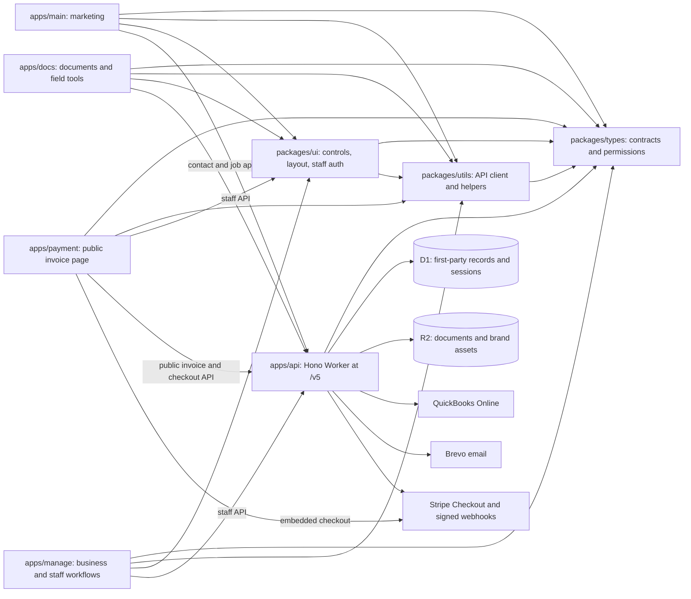
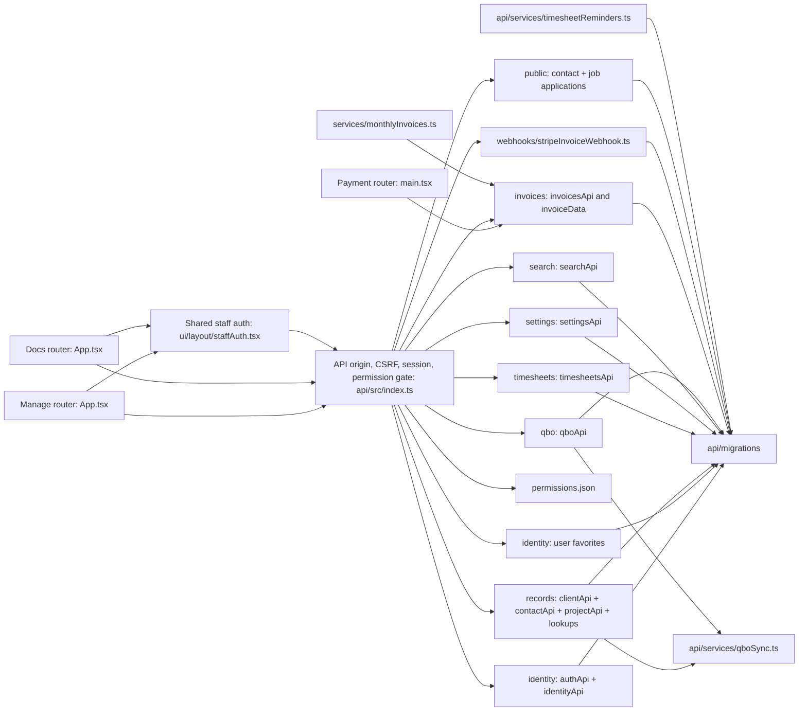
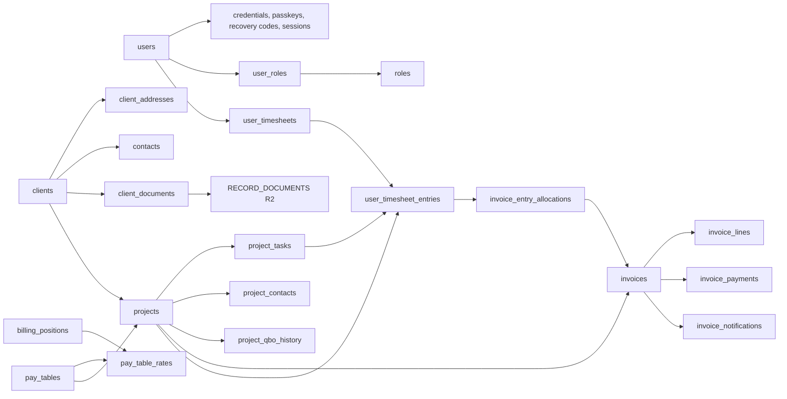

# Codebase knowledge graph

Snapshot: 2026-10-30. This maps the repository as implemented; it is not a deployment claim. The arrows show a dependency or a call, not ownership of the target. Dotted arrows show an expected path with no matching implementation. Start with the route and ownership tables when changing a feature, then follow the source links. Update this document when routes, contracts, persistence, or integration boundaries change.

## System graph

Solid edges reflect package dependencies or implemented calls. The API persists Stripe checkout sessions, verifies webhook signatures, and records confirmed payments before payout. Package edges come from each workspace `package.json`; runtime edges come from `apps/api/src/index.ts` and the app entry points.

## Feature graph

The API's public `/v5` prefix is stripped in `apps/api/src/index.ts` before Hono matches paths. `apps/api/src/security/routePolicies.ts` is the default-deny registry for every HTTP method and route pattern, including its consumer, authentication mode, permission, CSRF exemption, and handler-owned record boundary. Parity tests require an exact one-to-one match between the registry and Hono's registered routes. Handlers retain project, invoice, timesheet, document, and manager ownership checks. Public invoice tokens and the signed Stripe webhook have separate boundaries. `GET /health/status` is mounted directly. The Worker also has a `scheduled` entry point for timesheet reminders and monthly invoice drafts. `apps/api/wrangler.toml` declares UTC cron pairs; local New York time gates the reminders and 09:00 invoice run across daylight saving changes.

`POST /public/contact` and `/public/job-applications` accept configured first-party origins, validate and rate-limit submissions, and use the central Brevo service with server-owned recipients. All API email content is owned by `apps/api/src/emails`; the shared layout renders inline-styled HTML alongside plain text, while `src/services/brevo.ts` owns transport. `GET` and `PUT /identity/me/favorites` store authenticated Docs favorites in D1. Main, Manage, Docs, and Payment use the shared browser API client where applicable. The local D1 baseline now contains only active invoice allocation fields; project move history and QBO links remain.

## Route and feature index

| Surface | Implemented routes or features | Entry point and owner |
| --- | --- | --- |
| Manage | `/dashboard`, `/search`, `/me`; `/client`, `/client/new`, `/client/:id`; `/project`, `/project/new`, `/project/:id`; `/timesheets`, `/timesheets/:start`, `/timesheets/review`, `/timesheets/invoice-pool`; `/invoices`, `/invoices/:id`, `/invoices/payments`; `/settings`, `/settings/users`, `/settings/users/new`, `/settings/users/:id`, `/settings/roles`, `/settings/qbo`, `/settings/rates`. `/me` owns self-service security and is linked from the user menu. Invoice detail shows Stripe and QBO payment timing; the payment page shows payouts, holds, and notice retries. | `apps/manage/src/App.tsx`; `pages/me/MePage.tsx`; invoice pages and `invoiceDraft.ts` under `apps/manage/src/pages/invoices`. Most feature pages are lazy loaded. |
| Docs | Home and office pages; field parser and CXL editor; checklists, platting, ALTA references, handbooks, survey notes. Authenticated favorites use `/identity/me/favorites`. | `apps/docs/src/App.tsx`; tool and content modules under `apps/docs/src/pages`. Only survey notes are wrapped in `ProtectedRoutes` in this router; other Docs routes are visible without that route guard. |
| Payment | `/pay/:token` shows the token-scoped invoice, company settings logo, issued invoice and PO packet download, confirmed payments, and embedded Stripe checkout. | `apps/payment/src/main.tsx`, `pages/PayInvoicePage.tsx`; `packages/utils/src/invoicePdfCompiler.ts` renders invoice and hours pages; `invoicePdf.ts` merges packet pages and owns browser preview/download helpers. |
| Main | Marketing home, services, V5 contact submission, company, terms, privacy, and two CAD positions with on-site application. | `apps/main/src/App.tsx`, `pages/contactV2.tsx`, `pages/positions`; prerender script is part of the app build. |
| API identity | Setup, password login/reset and self-service change, staged TOTP replacement, recovery, passkey registration and removal, session, users, roles, permissions. | `apps/api/src/routes/authApi.ts`, `identityApi.ts`, `rolesApi.ts`, `userDetail.ts`; mounted at `/identity`. |
| API business | Client/project records and lookups, search, company settings and logos, QBO connection/sync, timesheets, invoices, public invoice access and checkout, contact and job submissions, staff favorites, Stripe webhook. | `apps/api/src/routes/clientApi.ts`, `contactApi.ts`, `projectApi.ts`, `recordLookupsApi.ts`, `searchApi.ts`, `settingsApi.ts`, `qboApi.ts`, `timesheetsApi.ts`, `invoicesApi.ts`, `publicApi.ts`, `favoritesApi.ts`, `src/webhooks/stripeInvoiceWebhook.ts`; mounted in `apps/api/src/index.ts`. |

The browser API clients in `apps/manage/src/api/client.ts` and `apps/docs/src/api/client.ts` use `createApiClient` from `@whitepoint/utils`. They default to `http://localhost:8787/v5` on localhost and the production API elsewhere. The public Payment page has a small token request helper and a local API default.

Manage `/dashboard` is owned by `apps/manage/src/pages/dashboard/BusinessDashboard.tsx`. It reads permission-filtered aggregates from `GET /dashboard` in `apps/api/src/routes/dashboardApi.ts` and `src/services/dashboardData.ts`; the response contract lives in `packages/types/src/types/dashboard.ts`. The API reads projects, invoices/payments, approved time, and active staff from D1. The new timesheet entry link opens the existing current-week dialog via the `new=1` query parameter.

## Ownership and data paths

| Area | Source of truth and entry point | Consumers or effects |
| --- | --- | --- |
| Workspace | `package.json`, `pnpm-workspace.yaml`, each workspace manifest | `types` is shared by all apps; `utils` depends on `types`; `ui` depends on both. |
| Authentication and permissions | `apps/api/src/auth`, `apps/api/src/routes/authApi.ts`, `apps/api/src/security/routePolicies.ts`, `apps/api/src/security/permissionCeiling.ts`, `apps/api/src/index.ts`, `packages/types/src/constants/permissions.json` | Manage and Docs use `packages/ui/src/layout/staffAuth.tsx` and an API-hosted session. The D1 login limiter uses hashed email/IP keys. Only `*` may manage super-administrator access; delegated user and role changes are capped to subsets of the actor's permissions. |
| Clients and projects | `apps/manage/src/pages/client`, `apps/manage/src/pages/project`, `apps/api/src/routes/clientApi.ts`, `contactApi.ts`, `projectApi.ts`, `recordLookupsApi.ts` | D1 is authoritative. `qboSync.ts` attaches QBO references after local saves; record documents use `RECORD_DOCUMENTS` R2. Shared contracts live in domain files under `packages/types/src/types` (`client`, `contact`, `project`, `task`, `invoicing`). |
| Timesheets and rates | `apps/manage/src/pages/timesheets`, `apps/manage/src/pages/settings/rates`, `apps/api/src/routes/timesheetsApi.ts`, `apps/api/migrations/0006_timesheet_init.sql` | `/timesheets/roster` supplies the selected week's active reporting tree or a permission-gated all-staff roster. Manage shows a day-focused entry view on phones and the project-by-day grid on wider screens. D1 holds draft, submitted, approved, and rejected weeks, rate snapshots, and the unreserved invoice pool. Worker cron runs reminders. |
| Company settings | `apps/manage/src/pages/settings`, `apps/api/src/routes/settingsApi.ts`, `src/services/companyBranding.ts` | D1 settings hold the company name and logo keys; logos use `BRAND_ASSETS` R2. Staff logo access uses the settings route. |
| Invoicing and payments | `apps/api/src/routes/invoicesApi.ts`, `invoicePaymentsApi.ts`, `src/services/invoiceData.ts`, `invoiceRead.ts`, `invoicePacket.ts`, `invoiceQbo.ts`, `stripeApi.ts`, `stripePayments.ts`, `paymentHold.ts`, `paymentNotices.ts`, `src/webhooks/stripeInvoiceWebhook.ts`; `apps/manage/src/pages/invoices`; `apps/payment/src/pages/PayInvoicePage.tsx` | D1 owns invoice terms, selected project-contact recipients, portion allocations and write-off reasons, PO snapshots, payments, and provider state. Project POs live in `RECORD_DOCUMENTS` R2; the optional billed T&M hours page, with separately selected entry notes, is inserted after the first invoice page and before PO PDFs; the issued invoice packet is generated once and served to Manage and Payment from R2. QBO customer payments, fee purchases, and payout transfers post after reconciled paid automatic payouts. |
| Marketing | `apps/main/src/App.tsx` | Standalone site using shared packages. |
| Documentation | `apps/docs/src/App.tsx`, `apps/docs/src/pages`, `apps/api/src/routes/favoritesApi.ts` | Public content and tools, protected survey notes, and authenticated D1 favorites. |

`packages/types/src/types` holds shared V5 contracts in client, contact, project, task, invoice, and search files. Main owns its single-app job listing type. Internal D1 row and app-specific user and role types stay local to their consumers. `packages/types/src/constants/permissions.json` is the permission catalog used by `PERMISSION_CATALOG` and `PERMISSION_KEYS`. `packages/utils/src/index.ts` exports the API client, session, favorites, dates, numbers, and invoice helpers. `packages/ui/src/input` exports the focused shared text, selection, checkbox, toggle, button, and OTP controls; `packages/ui/src/layout` provides auth, prompts, layout, modals, and error UI. Survey Notes owns bearing and multiselect controls under `apps/docs/src/pages/office/SurveyorNotesTsx/components`. Package export maps in their manifests define the supported import paths.

### Persistence relationships

Seven first-run migrations `0001` to `0007` under `apps/api/migrations` define the D1 schema by domain. Records and settings use revision checks; client and project saves batch related rows, audit entries, and numbering changes. Project detail derives approved time cost and charge totals from timesheet entries and invoice summaries from `invoices`. QBO customer, invoice, and payment IDs and sync status are references to an external system; local D1 records remain authoritative. Client document metadata lives in D1 and file bodies live in R2. `invoice_entry_allocations` reserves source entries.

The API now has a pure V5 seven-file migration baseline. User weekly hours is defined in `0003_user_init_auth_seed.sql`; the separate 0008 migration and V4 import, origin, and replay objects were removed. V5 Stripe webhook event IDs, provider IDs, and payout posting state remain the idempotency source of truth.

| Migration | Main responsibility |
| --- | --- |
| `0001_company_initialization.sql` | Company settings, numbering, record write guards, and QBO connection and accounting choices. |
| `0002_roles_permissions.sql` | Built-in roles and permission storage. |
| `0003_user_init_auth_seed.sql` | Users, authentication, user roles, audit, and initial administrator seed. |
| `0004_client_init.sql` | Clients, contacts, addresses, documents, and client numbering. |
| `0005_project_init.sql` | Projects, tasks, project contacts, PO metadata, and QBO move history. |
| `0006_timesheet_init.sql` | Billing positions, rates, user billing assignment, timesheets, entries, audit, and notifications. |
| `0007_invoice_init.sql` | Invoices, terms, recipients, portion allocations, PO snapshots, payments, Stripe checkout and payout reconciliation, adjustments, holds, and notices. |

### Important write paths

1. Manage client and project pages call `/records/*`, mounted from `clientApi.ts`, `contactApi.ts`, `projectApi.ts`, and `recordLookupsApi.ts`. Client/project saves validate the full record, use revision checks and D1 batches, then attempt `qboSync.ts`. QBO failures are stored for later retry. The project detail reads linked contacts/tasks, approved time costs, and invoice references.
   The project manager selector calls `/records/lookups/project-managers`, which lists active internal users whose active role grants `projects.assign.pm` or `*`; `projectApi.ts` checks the same rule on save. The central route gate in `apps/api/src/index.ts` grants this lookup to project viewers.
2. User detail pages call `identityApi.ts`. The new-user page reads `/identity/users/role-options` from `identityApi.ts` before its `/users/:id` route; `rolesApi.ts` owns role administration. `users` stores first, middle, last, suffix, and optional `weekly_hours` fields; `users_named` derives `display_name` for read queries. The detail API redacts pay, billing, and weekly target fields unless the caller has `timesheets.rates.view`; role and user changes are audited in D1.
3. Timesheet pages call `timesheetsApi.ts`. The weekly roster shows the reporting tree; `timesheets.view` opens the separate all-staff view. A manager can read descendants without a permission, while `timesheet.team.modify` allows draft and rejected entry edits and submission for descendants. Super-administrators can submit any user's draft or rejected timesheet. Submission snapshots the employee's rates and supports an explicit zero-hour week; the audit records the submitting actor. A reporting-chain manager with `timesheets.approve` approves or rejects; rejection remains visible until resubmission, and reopening is manager controlled. Approved T&M, NTE, and fixed fee entry balances not claimed by invoice allocations appear in the invoice pool.
4. QBO setup uses `qboApi.ts` for OAuth callback, choices, and disconnect. Disconnect requires `company.qbo.manage`, revokes the Intuit refresh token, then removes the local `qbo_connection`; the Manage settings page refreshes status. `qboSync.ts` writes top-level client customers and child project customers. The callback redirects to Manage settings.
5. Manual invoice creation selects approved time by default and reserves billed or written-off portions in `invoice_entry_allocations`; held portions remain available. The monthly job skips clients on payment hold, claims prior approved entry balances, and notifies the manager. The API computes due dates from issue date and selected terms. Invoice recipients are assigned project contacts; the primary contact and either billing POC marker are selected by default. Mark as Sent issues a PDF packet without email; Send Invoice attaches that packet to each selected unique email and tracks delivery separately. A verified succeeded Stripe PaymentIntent credits D1 even if its charge balance transaction is still null; later payout matching by charge ID fills the balance transaction, fee, and net values. Payout reconciliation and paid status then gate QBO payment, fee, and transfer posting. Manual payment entry updates D1 and QBO immediately. Refund/dispute events adjust D1 credit and place client holds; Manage provides super-administrator hold release and reviewed QBO payment correction.

### External edges and access boundaries

| Edge | Implemented path | Boundary |
| --- | --- | --- |
| Browser to API | `packages/utils/src/apiClient.ts`, `packages/ui/src/layout/staffAuth.tsx`, `apps/api/src/index.ts` | Allowed origins, session cookie, CSRF token for staff writes, route permissions and project ownership. Public invoice reads and checkout use opaque tokens. |
| API to QBO | `apps/api/src/routes/qboApi.ts`, `apps/api/src/services/qboSync.ts`, `invoiceQbo.ts` | OAuth connection and client/project customer sync plus sent invoice sync. Manual payments post on entry; Stripe customer payments, fee purchases, and bank transfers post after payout reconciliation and paid status. D1 keeps QBO IDs, status/error, and retries. A guided correction reduces or voids a posted QBO customer payment after finance review. Live QBO behavior needs separate verification. |
| API to Brevo | `apps/api/src/emails`, `src/services/brevo.ts`, and the calling auth, public, timesheet, invoice, and payment services | Source templates render HTML and plain text for every message. The central transport sends both formats; client invoice email attaches the issued PDF packet, and delivery tracking stays with the calling service. |
| API to R2 | `apps/api/src/routes/clientApi.ts`, `projectApi.ts`, `settingsApi.ts`, `invoicesApi.ts`, `src/services/companyBranding.ts`, `invoicePacket.ts` | Protected client and project PO documents, brand logos, and issued invoice packets use R2 with D1 metadata. Draft previews read active project POs; sent packet reads require invoice access or a sent/paid public token. Responses do not expose R2 keys. |
| Payment to Stripe | `apps/payment/src/pages/PayInvoicePage.tsx`, `apps/api/src/routes/invoicesApi.ts`, `apps/api/src/webhooks/stripeInvoiceWebhook.ts`, `apps/api/src/services/stripePayments.ts` | API persists and reuses checkout sessions for the current D1 balance. Signature verified webhook events confirm payments, retrieve charge/fee data, and reconcile automatic payouts. Refunds and disputes change credited amounts and place client holds; the browser return URL only refreshes status. |

## Weak areas

| Priority | Evidence | Effect and next action |
| --- | --- | --- |
| High | Stripe, Brevo, and QBO sandbox credentials are not available to the automated API tests. | Verify live provider checkout/webhook timing, email delivery, and QBO invoice/payment mapping in sandboxes before release. |
| Medium | `packages/ui/src/layout/staffAuth.tsx` is about 742 lines; `apps/api/src/routes/identityApi.ts` about 611; `apps/docs/src/pages/office/checklists/checklist.tsx` about 504. | These have broad review surfaces. Split by cohesive flow when modifying them, preserving active exports and routes. |
| Medium | `apps/api/tests` covers invoice timing, allocation math, API rights, Stripe event handling, and QBO retry behavior. `apps/manage/tests/currency.test.mjs` covers one formatting concern; frontend app manifests have no test script. | Run an interactive Manage and Payment review and provider sandbox checkout before release. |
| Medium | Package manifests use `^` ranges for many third-party dependencies despite `AGENTS.md` asking for hard references; the lockfile pins the current resolved tree. | A fresh dependency resolution could change versions. Decide whether the repository policy should require exact manifest versions, then align manifests and lockfile. |
| Low | `.agents/KEY DECISIONS.md` retains Clerk decisions that later entries override. | Read the latest overriding decision before identity work. Keep chronology clear. |

## Build and validation map

Root `package.json` defines `pnpm` workspace build, lint, typecheck, and per-app dev commands. `dev:manage` starts Manage and API; `dev:payment` starts Payment and API. Both app-level `dev` scripts start that app and API. Each path calls `scripts/dev.mjs`, which also starts a Stripe CLI listener for `/v5/webhooks/stripe`. The listener forwards Checkout, PaymentIntent, automatic payout, refund, and dispute events. It reads the test Stripe API key from `apps/api/.dev.vars`, obtains the CLI signing secret, and passes it to Wrangler. Stripe CLI access and network connectivity are required for that launch path. The root typecheck first builds `types`, `utils`, and `ui`, then checks workspaces. `apps/api/package.json` defines `node --test`; current tests are in `apps/api/tests`. `apps/manage/tests/currency.test.mjs` exists without a Manage `test` script. Each frontend app builds with TypeScript and Vite; Main also prerenders, using installed Chrome if bundled Playwright Chromium is absent. `apps/*/wrangler.toml` declares the Cloudflare Pages output, and the API Wrangler file declares the Worker resources. Use `pnpm.cmd` in PowerShell if the `pnpm.ps1` execution policy blocks the command. The seven migrations were validated against a fresh isolated local D1 store. An existing local D1 store with the old migration names needs a reset before running the new migration set; resetting removes its local data.

The primary source anchors are [API entry](../apps/api/src/index.ts), [Manage router](../apps/manage/src/App.tsx), [Docs router](../apps/docs/src/App.tsx), [Payment page](../apps/payment/src/pages/PayInvoicePage.tsx), [D1 migrations](../apps/api/migrations), [shared type exports](../packages/types/src/index.ts), [shared utility exports](../packages/utils/src/index.ts), [shared UI exports](../packages/ui/src/index.ts), and [key decisions](./KEY%20DECISIONS.md). Follow their imports for implementation detail.

When changing an edge, update this file with observed source paths. Remove a weak-area entry after implementation and relevant validation. D1 remains the source of truth for staff and business data; QBO IDs and sync status are linked references. Keep this graph at system and feature level; use the linked source files for exact field and route behavior.

## Page metadata and shared helpers

Manage and Docs route metadata is owned by each app's `src/routeMetadata.ts` and applied at its router root. Payment sets token-page metadata in `PayInvoicePage.tsx`. The common DOM metadata writer is `packages/utils/src/pageMetadata.ts`. Marketing SEO remains owned by `apps/main/src/components/seo/PageSeo.tsx`. The timesheet short-date formatter is owned by `apps/manage/src/pages/timesheets/model.ts`; marketing service lookup and cost formatting are owned by `apps/main/src/pages/servicePricing.ts`.

API route ownership: `rolesApi.ts` owns permissions and role management; `identityApi.ts` owns user management. `invoicePaymentsApi.ts` owns payout, hold, notice, and payment correction routes under `/invoices/payments`; `invoicesApi.ts` owns invoice routes. `timesheetConfigurationApi.ts` owns billing positions and rate tables under `/timesheets/configuration`; `timesheetsApi.ts` owns weekly time workflows. `invoiceRead.ts` owns invoice read models and paid-status refresh; `invoiceData.ts` owns draft creation and allocation writes. `services/writeGuard.ts` owns the D1 revision guard shared by record, timesheet, and invoice writes.
